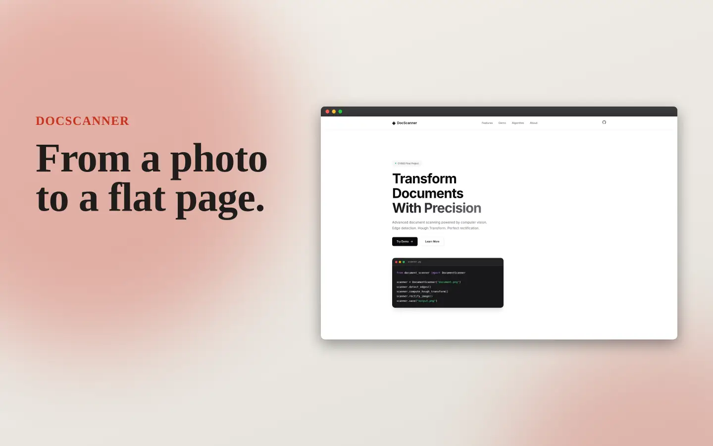
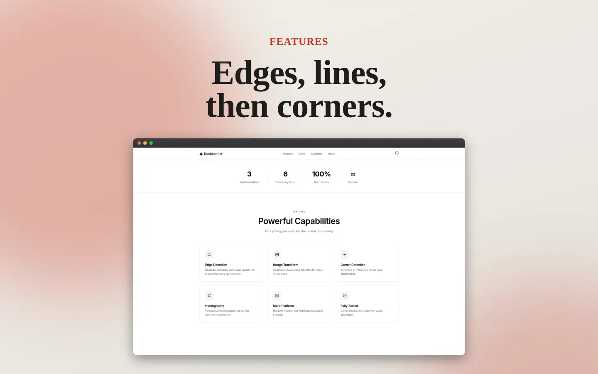
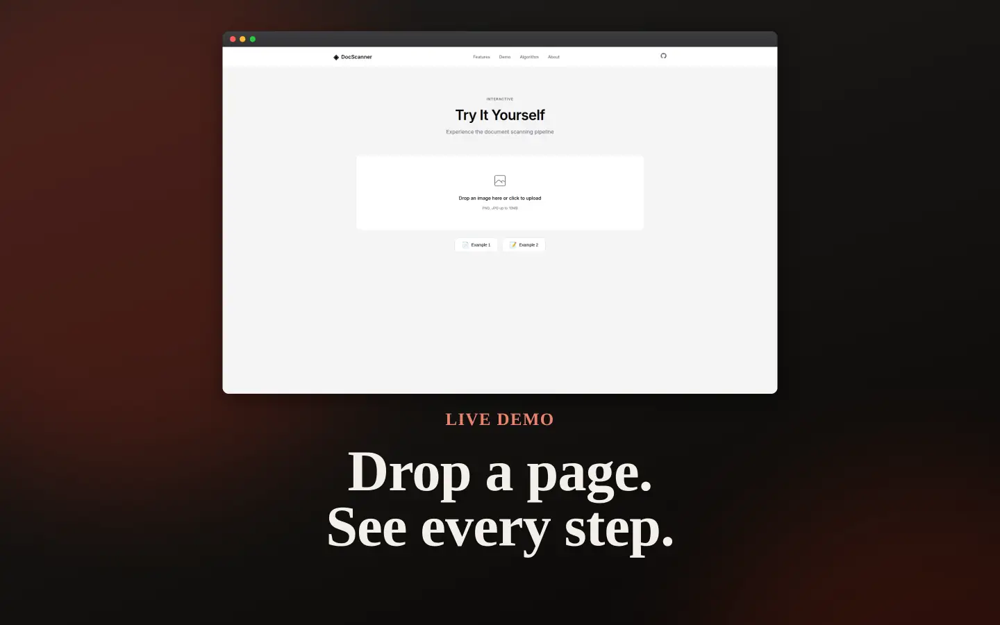
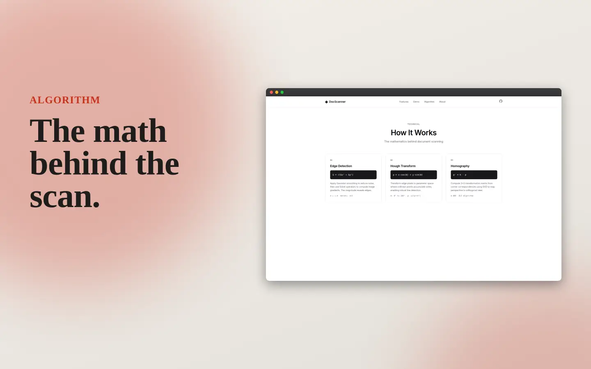
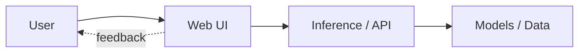

<div align="center">

# ◈ Document Scanner

**Next-Generation Document Processing with Computer Vision**

*Powered by Advanced Edge Detection • Hough Transform • Deep Learning Ready*

[](https://github.com)
[](https://www.mathworks.com)
[](https://www.python.org)
[](https://opencv.org)
[](LICENSE)
[](https://github.com)

[Live Demo](https://mangeshraut712.github.io/document-scanner-cv/) · [Documentation](#-documentation) · [Quick Start](#-quick-start) · [API Reference](#-api-reference)


</div>

---

## 🌟 Overview

A document scanning project that takes a photograph of a page, finds edges and lines, accepts four manual corners, and warps the result to a rectified letter-size image. Python, MATLAB, and a browser preview share that pipeline. Automatic corner detection and deep-learning plugins are not implemented yet.

### ✨ Key Features

<table>
<tr>
<td width="50%">

**🔬 Algorithms (as shipped)**
- Gaussian smoothing, then Sobel edge detection
- Hough Transform line detection
- Manual four-corner selection
- Perspective rectification via OpenCV `getPerspectiveTransform` (Python) or a 3x3 homography (MATLAB)

</td>
<td width="50%">

**🚀 Implementations**
- Python and MATLAB classes with method chaining
- Static HTML/CSS/JS browser demo
- Shared pipeline: edges → Hough → lines → corners → rectify

</td>
</tr>
<tr>
<td>

**🎨 Web demo**
- Minimal black-and-white page under `web/`
- Follows `prefers-color-scheme` for a dark theme
- Client-side preview only (no WebAssembly build)

</td>
<td>

**⚡ Output sizes**
- Python and MATLAB default to 8.5" x 11" at 300 DPI (2550 x 3300)
- Browser preview samples to 850 x 1100 (about 100 DPI)

</td>
</tr>
</table>

---

## Screenshots

Framed captures of the live web demo (current UI).

<div align="center">









</div>

---

## 🚀 Quick Start

### Web Demo (Zero Installation)

```bash
# Open in browser
open web/index.html

# Or serve with Python
python -m http.server 8000 --directory web
```

### Python (Recommended)

```bash
# Install dependencies
pip install -r requirements.txt

# Basic usage
python -c "
from src.python.document_scanner import DocumentScanner
scanner = DocumentScanner('examples/input1.png')
scanner.detect_edges().compute_hough_transform().rectify_image()
scanner.save_rectified('output.png')
"
```

### MATLAB

```matlab
% Add to path and run
addpath('src/matlab')
scanner = DocumentScanner('examples/input1.png');
scanner.detectEdges().computeHoughTransform().rectifyImage();
scanner.visualize('rectified');
```

---

## 📁 Project Architecture

```
document-scanner-cv/
├── src/matlab/
│   ├── DocumentScanner.m        # Scanner class
│   ├── run_scanner.m            # Example usage
│   ├── finalprojectimage1.m
│   └── finalprojectimage2.m
├── src/python/
│   └── document_scanner.py      # Scanner class (no package init or plugins/)
├── web/
│   ├── index.html
│   ├── styles.css
│   ├── script.js                # In-page preview (no Web Workers)
│   └── examples/
├── tests/
│   └── test_document_scanner.py
├── .github/workflows/
│   ├── ci.yml
│   └── pages.yml
├── docs/
│   ├── screenshots/
│   └── finalproject.latex
├── examples/                    # Sample images
├── requirements.txt
├── README.md
├── QUICKSTART.md
├── CONTRIBUTING.md
└── CHANGELOG.md
```

---

## 🔬 Advanced Features

The shipped Python and MATLAB scanners take an image path, run Sobel edges and a Hough transform, accept four manual corners, and rectify to a letter-size page at 300 DPI. Automatic corner detection, GPU backends, and plugin APIs are not in this repository.

```python
import numpy as np
from src.python.document_scanner import DocumentScanner

scanner = DocumentScanner("examples/input1.png")
scanner.sigma = 1.4
scanner.edge_threshold = 290
scanner.detect_edges()
scanner.compute_hough_transform()
scanner.detect_lines()

# Automatic corner detection raises NotImplementedError.
scanner.find_corners(np.array([
    [50, 50], [350, 50], [350, 450], [50, 450]
], dtype=np.float32))

scanner.rectify_image()            # default 8.5" x 11" at 300 DPI (2550 x 3300)
# scanner.rectify_image(400, 500)  # custom width, height
scanner.visualize("rectified", save_path="preview.png")
scanner.save_rectified("output.png")
```

The browser demo in `web/` is a separate in-page preview. It samples the document to 850 x 1100 (about 100 DPI), not the 300 DPI Python default.

---

## 📖 API Reference

### Python API

```python
class DocumentScanner:
    """Scan a document photo from a filesystem path."""

    input_image: np.ndarray
    sigma: float = 1.0
    edge_threshold: int = 290
    num_peaks: int = 6
    peak_threshold: float = 0.5

    def __init__(self, image_path: str):
        """Load an image file. Raises ValueError if the path cannot be read."""

    def detect_edges(self) -> DocumentScanner:
        """Gaussian smooth, then Sobel magnitude against edge_threshold."""

    def compute_hough_transform(self) -> DocumentScanner:
        """Build the Hough accumulator from the edge image."""

    def detect_lines(self) -> DocumentScanner:
        """Pick peaks using num_peaks and peak_threshold."""

    def find_corners(self, manual_corners: np.ndarray | None = None) -> DocumentScanner:
        """Set four (x, y) corners. Omitting them raises NotImplementedError."""

    def rectify_image(
        self, output_width: int | None = None, output_height: int | None = None
    ) -> DocumentScanner:
        """Warp to a letter-size page at 300 DPI (2550 x 3300) unless sizes are given."""

    def visualize(self, step: str, save_path: str | None = None) -> None:
        """Show edges, hough, lines, corners, or rectified. Optionally save the figure."""

    def save_rectified(self, output_path: str) -> None:
        """Write the rectified image with cv2.imwrite."""
```

### MATLAB API

```matlab
scanner = DocumentScanner(imagePath);
scanner.sigma = 1.4;
scanner.edgeThreshold = 290;

scanner = scanner.detectEdges() ...
                .computeHoughTransform() ...
                .detectLines() ...
                .findCorners(corners) ...
                .rectifyImage();           % default 8.5" x 11" at 300 DPI
% scanner = scanner.rectifyImage(2550, 3300);

scanner.visualize('rectified');           % edges | hough | lines | corners | rectified
```

There is no `saveRectified` method in the MATLAB class. Write `obj.rectifiedImage` with `imwrite` after rectification.

---

## 🎯 Use Cases

<table>
<tr>
<td width="33%">

### 📄 Document Digitization
- Scan receipts, invoices
- Archive old documents
- Convert books to PDF
- Preserve historical records

</td>
<td width="33%">

### 🎓 Education
- Homework scanning
- Whiteboard capture
- Note digitization
- Exam processing

</td>
<td width="33%">

### 🏢 Business
- Contract processing
- Form digitization
- ID card scanning
- Business card OCR

</td>
</tr>
</table>

---

## 🔬 Algorithm Deep Dive

### Edge Detection Pipeline

```
Input Image → Grayscale → Gaussian Blur → Sobel Operator → Threshold → Edge Map
              (RGB→L*)     (σ=1.0-2.0)     (3×3 kernel)    (adaptive)
```

**Mathematical Foundation:**

```math
G(x,y) = \frac{1}{2\pi\sigma^2} e^{-\frac{x^2+y^2}{2\sigma^2}}

G_x = \begin{bmatrix} -1 & 0 & 1 \\ -2 & 0 & 2 \\ -1 & 0 & 1 \end{bmatrix}, \quad
G_y = \begin{bmatrix} -1 & -2 & -1 \\ 0 & 0 & 0 \\ 1 & 2 & 1 \end{bmatrix}

|\nabla I| = \sqrt{G_x^2 + G_y^2}
```

### Hough Transform

```
Edge Pixels → Parameter Space → Accumulator → Peak Detection → Lines
              (ρ,θ mapping)      (voting)       (NMS)
```

**Polar Representation:**

```math
\rho = x \cos\theta + y \sin\theta

\text{where } \theta \in [0°, 180°], \quad \rho \in [-\sqrt{w^2+h^2}, \sqrt{w^2+h^2}]
```

### Homography Estimation

```
Corner Points → DLT Algorithm → SVD Decomposition → Homography Matrix → Warp
                (8 equations)    (least squares)     (3×3 matrix)
```

**Transformation:**

```math
\begin{bmatrix} x' \\ y' \\ 1 \end{bmatrix} = 
\begin{bmatrix} h_{11} & h_{12} & h_{13} \\ h_{21} & h_{22} & h_{23} \\ h_{31} & h_{32} & 1 \end{bmatrix}
\begin{bmatrix} x \\ y \\ 1 \end{bmatrix}
```

---

## 📊 Performance Benchmarks

This repository does not ship a timed benchmark suite, a GPU/WebAssembly build, or a DocBank evaluation. Earlier numbers in this section were not reproducible from the code here, so they have been removed.

Python and MATLAB output letter-size pages at 300 DPI by default. The browser demo is a lighter 100 DPI preview.


## 🛠️ Advanced Configuration

There is no `ScannerConfig` class and `DocumentScanner` does not take a config object. Tune the instance attributes, then call the pipeline methods:

```python
scanner = DocumentScanner("examples/input1.png")
scanner.sigma = 1.4
scanner.edge_threshold = 150
scanner.num_peaks = 6
scanner.peak_threshold = 0.5
```

MATLAB uses the same idea: set `scanner.sigma`, `scanner.edgeThreshold`, `scanner.numPeaks`, and `scanner.peakThreshold` before `detectEdges()`.

---

## 🧪 Testing

The repository ships a Python unit suite in `tests/test_document_scanner.py`. There is no MATLAB test runner, no `web` npm test script, and no `tests/integration/` tree.

```bash
# From the repo root, with the Python dependencies installed
pytest tests/ -v
```

### Continuous Integration

The workflow in `.github/workflows/ci.yml` currently:
- Runs the Python tests on 3.10, 3.11, 3.12, and 3.13
- Lints `src/python` with flake8 and black
- Checks that README.md and CONTRIBUTING.md exist
- Confirms the web demo files exist and runs ESLint on `web/script.js` (non-blocking)

---

## 🚀 Deployment

This repository does not include a Dockerfile, Kubernetes manifest, or Lambda handler, and `DocumentScanner` only accepts a filesystem path (not raw bytes).

Run the Python or MATLAB classes locally, or serve the static demo:

```bash
python -m http.server 8000 --directory web
# then open http://localhost:8000
```

---

## 🤝 Contributing

We welcome contributions! See [CONTRIBUTING.md](CONTRIBUTING.md) for guidelines.

### Development Setup

```bash
# Clone repository
git clone https://github.com/mangeshraut712/document-scanner-cv.git
cd document-scanner-cv

# Create virtual environment
python -m venv venv
source venv/bin/activate  # or `venv\Scripts\activate` on Windows

# Install dependencies (there is no requirements-dev.txt or pre-commit hook)
pip install -r requirements.txt

# Run tests
pytest tests/ -v
```

### Areas for Contribution

- 🎯 **Automatic corner detection** using deep learning
- ⚡ **GPU acceleration** for Hough Transform
- 📱 **Mobile app** (React Native)
- 🔍 **OCR integration** for text extraction
- 📊 **Batch processing** UI
- 🌍 **Multi-language** support

---

## 📚 Resources

### Documentation
- API Reference in this README
- [QUICKSTART.md](QUICKSTART.md)
- [web/README.md](web/README.md)

### Research Papers
1. Canny, J. (1986). *A Computational Approach to Edge Detection*
2. Duda, R. O., & Hart, P. E. (1972). *Use of the Hough Transformation*
3. Hartley, R., & Zisserman, A. (2003). *Multiple View Geometry*
4. Zhang, Z. (2000). *A Flexible New Technique for Camera Calibration*

### Related Projects
- [OpenCV](https://opencv.org/) - Computer Vision Library
- [scikit-image](https://scikit-image.org/) - Image Processing
- [DocTR](https://github.com/mindee/doctr) - Document OCR
- [LayoutParser](https://layout-parser.github.io/) - Document Layout Analysis

---

## 📝 License

This project is licensed under the MIT License - see the [LICENSE](LICENSE) file for details.

---

## 🙏 Acknowledgments

- **CV583 Course** - Computer Vision fundamentals
- **OpenCV Community** - Excellent documentation and support
- **shadcn/ui** - Beautiful component design inspiration
- **Vercel** - Design system inspiration

---

## 📞 Contact & Support

<div align="center">

**Author:** Mangesh Raut  
**Course:** CV583 — Computer Vision  
**Institution:** [Your University]

[](https://github.com/mangeshraut712)
[](mailto:your.email@example.com)
[](https://linkedin.com/in/yourprofile)

### ⭐ Star this repository if you find it helpful!

[Report Bug](https://github.com/mangeshraut712/document-scanner-cv/issues) · 
[Request Feature](https://github.com/mangeshraut712/document-scanner-cv/issues) · 
[Discussions](https://github.com/mangeshraut712/document-scanner-cv/discussions)

</div>

---

<div align="center">

**Made with ❤️ using Computer Vision**

*Transforming documents, one pixel at a time*

</div>

---

<!-- codex:project-diagram:start -->

## Project Diagram



_How the web layer connects to model or document processing logic._

<!-- codex:project-diagram:end -->
